  

  

  <em>Sí, esa misma que se la pasó molestando a la IA todo el rato.</em>

  

Si quieres ver todo junto, armé un portafolio. Ahí está lo de ensamblar avatares
para VRChat, los proyectos en los que ando, las herramientas que uso y todos mis
enlaces. Sí, otra página más, pero esta es la que junta a las demás.

- Está en cuatro idiomas: español, japonés, inglés y portugués.
- La hice a mano, igual que la tienda, y desde ahí también acepto encargos.
- Tiene un visor que gira cada avatar en 36 fotos, y salidas directas a la tienda y al ATELIER.
- Mis redes quedan en un solo lugar: GitHub, X, YouTube, Steam y Discord.

> Ojo: mi X puede tener contenido +18, así que la página te avisa antes de
> mandarte para allá.

Visítalo aquí: **[mirulab.pages.dev](https://mirulab.pages.dev)**

  

Estoy contribuyendo en **Project Miru**, una IA VTuber que puede:

- Leer el chat e interactuar con sus seguidores en vivo
- Hacer chistes y conversar con la gente
- Y la meta a futuro: que todo funcione en tiempo real, sin depender de *paper lines* (líneas pregrabadas o guionizadas)

> Mi rol: contribuidora.
>
> Spoiler: la IA aprendió tan rápido que ahora la que pregunta cosas raras soy yo.

Mira el proyecto aquí: [Project Miru](https://github.com/ProZero133/ProjectMiru)

También trabajé como programadora en **Luna Has Gone** (Saikey Studios), un RPG
con fondos prerrenderizados estilo PS1: combate por turnos, gestión de recursos y
exploración, donde juegas como Misha buscando a su amiga Luna.

> Mi rol: programadora de plugins para el motor RPG Maker. Mi parte en el
> proyecto ya está terminada.

Disponible en Steam: [Luna Has Gone](https://store.steampowered.com/app/4483420/Luna_Has_Gone/) · [Página del estudio](https://saikeystudios.com/product/luna-has-gone/)

Y por mi cuenta tengo dos cosas andando:

**Avatar Optimizer**, un plugin de Unity que revisa un avatar de VRChat y le quita
lo que sobra, como huesos sueltos o físicas que nadie usa. Hace copia de seguridad
y deja volver atrás, porque aprendí por las malas que hay que poder deshacer.

> Mi rol: herramienta propia, hecha en C# para Unity.

**Mechanis**, una defensa por oleadas cooperativa con progresión de RPG. No hay
clases: los roles salen de un sistema de cartas, y las torretas se arman por
secciones, pieza a pieza.

> Mi rol: proyecto propio en Unity (URP 2D), todavía en desarrollo.

Lo más nuevo es **THREELETARIAT**, un juego colaborativo en Unity que recién
arranca. De ese todavía no puedo contar mucho.

Y le di una mano a [Kogamike](https://github.com/Kogamike) con **WT-Web**, la
página de Wizards of Tomorrow, una tienda de tecnología con temática de magos. Le
armé el panel de gestión interno, cambié el chat externo por un asistente propio y
arreglé lo que salió en la revisión del sitio.

  

**Rewrite Gamble** es el juego del equipo de Aurora, un 2D hecho en Unity que pasa
en un casino. Entré en julio para echar una mano con la sala del casino y terminé
sentada en la mesa con media baraja.

  

Así fue la partida, mes a mes:

| Mes | Lo que puse en la mesa |
|---|---|
| Julio | La sala del casino: amueblé PlotHouse, el mostrador y todo el primer piso con sus colliders y el orden en que se dibujan los sprites. |
| Agosto | Recorté el suelo al octágono, junté el trabajo de todo el equipo en una sola rama, y llegaron las luces que se prenden al acercarte, las luciérnagas, una llama animada, sombras que desaparecen al entrar en la luz y la rueda de emotes en la Q. |
| Septiembre | El combate V002, con rondas, fichas que ganas cuando un ataque te pasa rozando y el marcador de combo y saldo. |
| Octubre | Rachas por escalones, cartas teledirigidas con más margen para esquivarlas, ventanas con luz azulada y la escena del Clover Bar. |
| Noviembre | La escena de retry, la oficina de Evelyth con su punto de guardado en el reloj, caras que cambian en cada línea de diálogo, los menús de maleta e inventario, controles reasignables y arreglos del audio con Wwise. |

Y de paso sigo cuidando que el repositorio del equipo no se enrede.

> Mi rol: código en Unity (2D), con más de 40 commits en el repo del equipo.
> Todavía en desarrollo.

  

Para la materia de Creación de universos, en la universidad, hicimos en equipo
**MYCELION, Archivo de Memorias Perdidas**: un universo narrativo donde todo se
conecta como el micelio de los hongos. A mí me tocó la web, y quedó como una
experiencia en 3D que se recorre por capítulos.

- Son cinco capítulos con 12 Semillas de Memoria escondidas, y el final cambia según lo que decidas en la Cámara de Resonancia.
- Tiene una enciclopedia con las 33 fichas del mundo, buscador y un grafo que muestra cómo se conecta cada cosa.
- Si el navegador no tiene WebGL, se ve en una versión 2D. Y hay otra copia que abre sin internet y sin servidor, con doble clic, desde un USB.

> Mi rol: la web, hecha en Next.js con React Three Fiber. Como es trabajo de la
> uni, el repo es privado.

  

> Este perfil notifica que miru (chara2029vr) forma parte del equipo de
> contribuidoras del proyecto Project Miru. Cualquier parecido entre el caos del
> código y mi personalidad es pura coincidencia.

  

No solo programo. También:

- Hago modelado 3D y modelos propios para realidad virtual (VR), y a veces subo
  ese contenido a mi X.
- Subo animaciones MMD a mi canal de YouTube. No es un canal grande, pero sirve
  para ver mis modelos en movimiento como referencia.
- Soy editora de video y audio.
- Trabajo con varias herramientas de Adobe (Photoshop, Illustrator, entre otras).

  

Tengo una vitrina/tienda de avatares de VRChat que ensamblo a medida (bases,
accesorios, ropa y físicas). La página la hice a mano, con su intro de neón,
galería, música y un montón de detalles.

Desde septiembre creció bastante. Ya van 61 avatares, y ahora tiene un catálogo de
ropa aparte con más de 1.300 cosas: ropa, pelo, accesorios, texturas, animaciones
y sistemas, de más de 500 tiendas de BOOTH. En cada prenda sale con qué avatares
es compatible, los modelos que comparten cuerpo van agrupados por familia y lo que
es gratis tiene su etiqueta. Lo +18 va aparte, en su propia sección.

> Aviso: yo no creé las bases. Cada modelo base es de quien lo creó originalmente,
> y los derechos y créditos son de esa persona. Yo solo me encargo del ensamblado.

Visítala aquí: **[neonekostore.pages.dev](https://neonekostore.pages.dev)**

  

Esta es la parte de atrás de la tienda, el taller. Ahí hay 24 modelos contados uno
por uno, con sus fotos y sus datos, y aparte el proceso completo con el que los
ensamblo, explicado en seis pasos con capturas reales de cada uno.

También cuento algo que casi nadie explica: por qué un modelo pesa lo que pesa y
qué límites hay que respetar para que ande bien dentro de VRChat.

- La hice a mano sobre Bootstrap 5.3, sin build ni instalación.
- Las tipografías y las librerías van dentro del repo, así que la página abre igual
  sin conexión.

Entra aquí: **[atelier-neoneko.pages.dev](https://atelier-neoneko.pages.dev)**

  

**IRAI** (依頼, que en japonés quiere decir "encargo") es la página de mis
encargos, y ahí se ve la cola tal como va.

- La mesa muestra en qué estoy trabajando ahora y cuántos días lleva ahí.
- La línea tiene las seis estaciones por las que pasa cada encargo, desde crear el proyecto hasta entregarlo. No aparecen nombres ni datos de nadie, solo un número, y con ese número puedes seguir el tuyo.
- En la bitácora voy dejando notas cortas de lo que avanzo, y hay una pared para los nombres de quien apoye el taller por Ko-fi.
- Para encargar hay un formulario que te calcula un precio aproximado según la ropa, los accesorios, los toggles y las físicas que pidas.

Esta me tocó hacerla más en serio que las otras: Astro con Preact, una API en
Cloudflare Pages Functions, base de datos en D1, fotos en R2 y un panel privado
desde donde muevo la cola. También está en cuatro idiomas.

Pasa por aquí: **[iraimiru.pages.dev](https://iraimiru.pages.dev)**

  

Antes de que cerrara TuMangaOnline (TMO), trabajé en **Yashiro Scan** (ahí me
conocían como Rimury), un grupo de scanlation donde aprendí lo que es sacar
proyectos en equipo, y casi siempre a contrarreloj.

Encuéntralos aquí: [Yashiro Scan en Facebook](https://www.facebook.com/profile.php?id=100070363143406)

  

  
  
  
  
  
  
  
  
  
  
  
  
  
  
  

  

  
  
  

  <picture>
    <source media="(prefers-color-scheme: dark)" srcset="https://raw.githubusercontent.com/chara2029vr/chara2029vr/output/github-contribution-grid-snake-dark.svg" />
    <source media="(prefers-color-scheme: light)" srcset="https://raw.githubusercontent.com/chara2029vr/chara2029vr/output/github-contribution-grid-snake.svg" />
    
  </picture>

<em>(Esa serpiente se va comiendo mi grid de contribuciones; el workflow la regenera cada 24 h)</em>

  

  
  &nbsp;
  
  &nbsp;
  
  &nbsp;
  

  
  &nbsp;
  
  &nbsp;
  
  &nbsp;
  

  
  &nbsp;
  

  <em>X: modelado 3D y VR · YouTube: animaciones MMD con mis modelos</em>

Proyecto destacado: [Project Miru](https://github.com/ProZero133/ProjectMiru). Si te gusta lo que hace Miru, dale una estrella al repo.

  

  <em>Hecho con cariño y café.</em>

